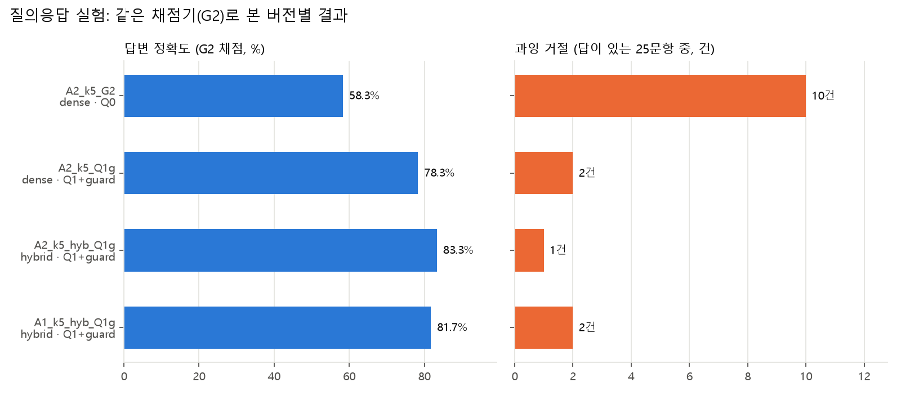
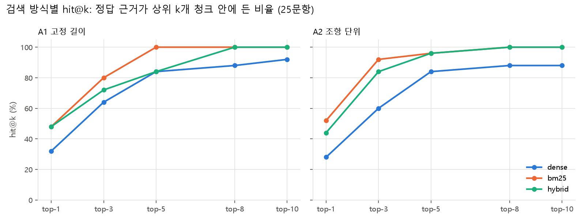
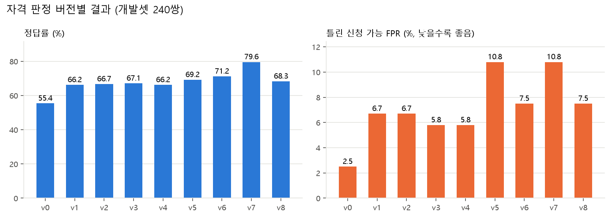

# 6단계 실험 로그

실험마다 `data/eval/experiments.csv`에 지표가 자동으로 한 줄씩 쌓인다 (`run_qa_eval.py`). 그래프는 `python plot_experiments.py`로 다시 그린다.

## A. 질의응답 (30문항: 답 있음 20, 문서에 없음 5, 함정 5)

### 비교 원칙
- 채점기가 바뀌면 점수가 달라지므로, 버전 비교는 **같은 채점기(G2)**로 채점한 결과끼리만 한다.
- 채점기는 사람 판정과의 일치(카파)로 먼저 검증했다.

### 실험 순서와 결과

| # | 실행 | 바꾼 것 | 검색 | 답변 | 채점 | 정확도 | 과잉 거절 | 함정 | 인용 정확도 | hit@1 / hit@5 |
|---|---|---|---|---|---|---|---|---|---|---|
| 0 | A2_k5 | 기준선 | dense | Q0 | G0 | 61.7% | 10/25 | 50% | 93% | 32% / 84% |
| 1 | A2_k5_G1 | 채점기 보정 (핵심/보너스 구분) | dense | Q0 | G1 | 68.3% | 10/25 | 50% | 93% | 32% / 84% |
| 2 | A2_k5_G2 | 채점기 보정 + 코드 규칙 (함정에서 거절은 오답) | dense | Q0 | **G2** | **58.3%** | 10/25 | 0% | 93% | 32% / 84% |
| 3 | A2_k5_Q1 | 답변 프롬프트 Q1 (근거 인용 먼저, 전제 확인) | dense | Q1 | G1 | 80.0% | 1/25 | 90% | 67% | 28% / 84% |
| 4 | A2_k5_Q1g | Q1 + 인용 검증 가드 | dense | Q1+guard | G2 | 78.3% | 2/25 | 80% | 78% | 28% / 84% |
| 5 | **A2_k5_hyb_Q1g** | 검색을 hybrid(임베딩 + BM25)로 | hybrid | Q1+guard | G2 | **83.3%** | **1/25** | 80% | **92%** | 44% / 96% |
| 6 | A1_k5_hyb_Q1g | 같은 설정, A1 청킹 | hybrid | Q1+guard | G2 | 81.7% | 2/25 | 80% | 78% | 48% / 84% |

같은 채점기(G2) 기준으로 **기준선 58.3% → 현재 최고 83.3% (+25.0%p)**, 과잉 거절 10건 → 1건.

### 실험별 메모

**#1~2 채점기 보정.** 4단계에서 LLM 채점(G0)과 사람 채점의 카파가 0.44였다. LLM은 정답 칸의 보너스 정보까지 요구해 답 있음 문항을 깎고, 함정에서 "확인 불가"라고 한 답은 부분정답으로 봐줬다.

| 채점기 | 일치율 | 카파 | 남은 차이 |
|---|---|---|---|
| G0 기본 | 63% | 0.44 | 보너스 요구 6, 함정 거절 봐줌 5 |
| G1 프롬프트 보정 | 77% | 0.59 | 보너스 요구 2, 함정 거절 봐줌 5 (프롬프트에 규칙을 써도 무시) |
| G2 = G1 + 코드 규칙 | **90%** | **0.81** | 보너스 요구 3 (A11, A12, A19) |

G1은 프롬프트에 "함정에서 거절은 오답"이라고 적어도 5문항 모두 부분정답을 줬다. 그래서 G2는 이 규칙을 코드로 강제한다 (`rule_grade`). 이후 비교는 모두 G2로 한다. G2도 보너스 정보 누락을 부분정답으로 보는 경향이 남아 있어, 사람 기준보다 3문항 정도 낮게 나온다.

**#3 답변 프롬프트 Q1.** 기존 프롬프트(Q0)는 출력 JSON이 `found`(답을 찾았는지)부터 쓰게 되어 있었다. 그래서 근거를 따지기 전에 거절을 정하는 것으로 보였다. Q1은 ① 근거 문장 원문 인용 → ② 질문 전제 확인(맞음/틀림/확인 불가) → ③ 인용이 있으면 답 순서로 쓰게 했다. 전제가 틀렸으면 "아닙니다"로 시작하게 했다.
- 과잉 거절이 10건에서 1건으로 줄었고, 함정 문항은 50%에서 90%가 됐다. 예를 들어 T02에는 "아닙니다. 지원대상은 만 15세~34세라 38세 직원은 대상이 아닙니다"라고 답했다.
- 대신 새 실패가 생겼다. T01은 정답 청크가 검색되지 않았는데도 인용 없이 다른 공고(대체인력 인건비)의 "월 100만원 × 10개월"로 확신 있게 답했다. 거절보다 위험한 오답이다.

**#4 인용 검증 가드.** 모델이 인용한 문장이 검색된 청크에 실제로 있는지 코드로 확인한다 (기호·띄어쓰기 차이 무시, 떨어진 줄을 이어 붙인 인용은 조각 70% 이상 일치 시 인정). 확인된 인용이 하나도 없으면 답을 거절로 바꾼다. 인용 id를 잘못 적은 경우는 실제 문장이 있는 청크로 고친다.
- T01이 다른 공고 금액으로 답하던 것이 거절로 바뀌었다. 점수는 조금 내려가지만(80.0 → 78.3, 채점기도 G1 → G2로 달라짐) 지어낸 답 1건을 막았다.
- 인용 id 오기 2건(A17, T04)을 바로잡아 인용 정확도가 67%에서 78%로 올랐다.

**#5 hybrid 검색.** 검색만 따로 비교했다 (`eval_retrieval.py`, 답변 생성 없음).

| 청킹 | 검색 | hit@1 | hit@3 | hit@5 | hit@8 | MRR | top-5 밖 |
|---|---|---|---|---|---|---|---|
| A1 | dense | 32% | 64% | 84% | 88% | 0.502 | A03, A16, T01, T05 |
| A1 | bm25 | 48% | 80% | 100% | 100% | 0.670 | - |
| A1 | hybrid | 48% | 72% | 84% | 100% | 0.641 | A03, A16, T01, T05 |
| A2 | dense | 28% | 60% | 84% | 88% | 0.487 | A03, A05, A16, T01 |
| A2 | bm25 | 52% | 92% | 96% | 100% | 0.728 | A02 |
| A2 | hybrid | 44% | 84% | 96% | 100% | 0.657 | A02 |

- 키워드 검색(BM25)이 가장 좋다. 다만 평가 질문을 공고 문장을 보며 만들어서 질문과 근거가 단어를 많이 공유한다. 그래서 BM25가 실제보다 유리하게 나왔을 가능성이 크다. 실제 사용자는 다른 표현으로 묻기 때문에, 의미 검색(dense)과 섞은 hybrid를 기본으로 택했다.
- dense 검색이 놓치던 공고 첫 청크(A03, T01: 머리말·개요·표가 섞인 청크)를 hybrid가 찾았다. 검색 결과가 좋아지면서 A13(해외 OEM)도 정답 청크를 인용해 맞혔다.
- A2가 hybrid에서 hit@5 96%로 A1(84%)보다 높아 A2를 기본 청킹으로 유지한다.

### 남은 오류 (A2_k5_hyb_Q1g)

| qid | 판정 | 내용 | 다음 조치 |
|---|---|---|---|
| T01 | 오답 | 정답 청크가 3순위로 검색됐다. 그런데 '대전 인건비' 공고가 두 개(소상공인 인건비, 육아휴직 대체인력 인건비)라 모델이 거절했다. | 공고가 여러 개면 "어느 사업인지" 되묻거나 둘 다 안내 |
| N03 | 오답 | 지급 시기 질문에 기간(최대 24개월)으로 답했다. Q1의 "관련 사실만 있으면 확인되지 않는다고 쓰기" 규칙을 지키지 않았다. | 전제 확인처럼 '질문이 묻는 것이 인용에 직접 있는가'를 별도 칸으로 확인 |
| A02 | 오답(채점) | "소진공에 별도 신청"이라고 답했다. 원문과 맞지만 정답 칸의 '소상공인24'가 없어 오답 처리됐다. | 채점 이견. 사람 판정으로 확인 |
| A08, A12, A18, A19 | 부분정답 | 핵심은 맞고 보너스 정보가 빠졌다. G2가 엄격하게 본 경우다. | 채점기 한계로 기록 |

## B. 자격 판정 (프로필 × 공고, 개발셋 240쌍)

| 버전 | 바꾼 것 | 정답률 | FPR | 조건부로 물러섬 |
|---|---|---|---|---|
| v0 | 기본 추출 프롬프트 (기준선) | 55.4% | 2.5% | 6.2% |
| v1 | 신청자 본인 자격만 추출 | 66.2% | 6.7% | 8.8% |
| v2 | 업종 제외 표를 코드로 판정 | 66.7% | 6.7% | 8.4% |
| v3 | 업종 이름을 시뮬레이터 질문으로 | 67.1% | 5.8% | 8.4% |
| v4 | 추출 프롬프트 2차 (채택 안 함) | 66.2% | 5.8% | 13.3% |
| v5 | 지역·나이·업력·매출 근거를 원문 문장으로 코드 검증 | 69.2% | 10.8% | 10.6% |
| v6 | 제외 사유만 원문 전체에서 2차 추출 | 71.2% | 7.5% | 8.8% |
| **v7** | 조건 성격 검토 단계 + 업력 예외 질문 + 예비창업자 허용 + 근로자 나이 검증 보강 | **79.6%** | 10.8% | **5.8%** |

| 지표 | v6 | v7 |
|---|---|---|
| 정답률 | 71.2% | 79.6% |
| '가능'을 맞힘 (정답=가능 106쌍) | 58 | 82 |
| 틀린 신청 불가 | 39 (16%) | 22 (9%) |
| 틀린 신청 가능 (FPR) | 9/120 = 7.5% | 13/120 = 10.8% |
| 조건부로 물러섬 | 8.8% | 5.8% |
| 이유까지 맞은 불가 | 91/120 | 89/120 |

**v7에서 바꾼 것.** 오답노트에서 판정 오류의 65%가 추출 단계였고, 그중 상당수가 "이 조건이 누구에게, 어떤 성격으로 걸리는가"를 잘못 읽은 경우였다. 추출 프롬프트(v1)에는 "근로자 나이·가점·일부 트랙 조건은 넣지 마라"는 규칙이 이미 있었는데도 지켜지지 않았다. 그래서 프롬프트를 늘리는 대신 단계를 하나 추가했다.
1. **조건 성격 검토** (`role_check`, gpt-4.1-mini): 추출된 조건마다 공고 원문 전체와 대조해 필수 / 일부트랙 / 가점우대(배정 몫 포함) / 의무절차 / 다른대상(근로자 등) / 분류정보 / 근거없음 중 하나로 판정한다. 필수가 아닌 조건은 코드가 버린다 (`apply_roles`).
2. **업력 예외** (`biz_exception_for`): "7년 이내(신산업 최대 10년)" 같은 예외를 찾으면, 업력이 예외 구간에 있는 프로필에게만 예외 질문("신산업 분야인가요?")을 한다.
3. **예비창업자 허용:** 원문에 예비창업자도 신청 가능하다고 적혀 있으면 신청 대상에 추가한다.
4. **근로자 나이 검증 보강:** 숫자 바로 뒤에 근로자·채용·인력이 오면, 문장에 '사업주'가 있어도 대표자 나이 조건에서 뺀다.

**1차 실행에서 고친 것.** 1차는 77.5%였다. 새로 틀린 쌍 10개를 확인해서 두 가지를 고쳤다.
- 신청 대상이 '여성기업'처럼 정해진 목록 밖의 단어뿐일 때 예비창업자를 추가하면, 예비창업자만 남는 코드 버그가 있었다 (3쌍).
- 검토 단계가 "청년을 정규직으로 채용했나요?"(신청자가 해야 하는 일)를 '다른대상'으로 분류했다. 그래서 검토 기준에 "신청자의 행위·사업장 상태는 필수"를 추가했다 (1쌍).

**새로 틀린 6쌍은 모두 'v6가 엉뚱한 이유로 맞힌 경우'다.** 정답은 불가인데, v6는 잘못 뽑힌 조건(근로자 나이, K-Startup 업력 목록, 배정 몫 나이) 때문에 우연히 불가를 맞히고 있었다. v7이 잘못된 조건을 지우자, 원래 잡아야 할 조건(최저임금 지급, 2026년 신규 채용, 업종, 신용점수)을 놓치고 있었다는 게 드러났다. FPR이 7.5%에서 10.8%로 오른 것은 이 때문이다. 정답률만 보면 놓치는 부분이라, '이유까지 맞은 불가'를 함께 기록한다.

**v8: 누락 조건 보충 (채택 안 함).** 틀린 신청 가능 13건이 모두 조건 누락이라, 검토 단계에서 '원문 신청 자격 중 목록에 빠진 필수 조건'을 찾아 보충했다. 보충 조건은 근거 문장이 원문에 글자 그대로 있어야 받아들였다.

| 시도 | 방법 | 정답률 | '가능' 맞힘 | FPR | 틀린 불가 | 조건부 |
|---|---|---|---|---|---|---|
| v7 (기준) | - | 79.6% | 82 | 10.8% | 22 | 5.8% |
| v8 1차 (`v8_try1`) | 성격 판정 + 누락 보충을 한 호출로 | 74.6% | 75 | 12.5% | 23 | 9.7% |
| v8 2차 | 성격 판정은 v7 것 그대로, 누락 보충만 별도 호출 | 68.3% | 54 | **7.5%** | 36 | 13.7% |

- **1차가 망가진 이유: 판정 흔들림.** 프롬프트가 바뀌어 검토 단계 전체를 다시 돌렸더니, 같은 조건 158개 중 5개(3%)의 성격 판정이 v7과 달라졌다. 공고 15·18·25의 가점·의무 질문이 '필수'로 바뀌었다. 온도 0이어도 프롬프트가 조금 바뀌면 판정이 흔들린다. 공고 하나의 판정이 바뀌면 그 공고 프로필 4~5쌍이 함께 움직인다. 그래서 2차에서는 성격 판정을 v7 결과로 고정하고 보충 효과만 분리했다.
- **2차가 망가진 이유: 보충 자체가 과함.** FPR은 10.8%에서 7.5%로 줄어 노린 효과는 있었다 (18-P03 팀 지분 조건, 02-P06 창업도시 Pool 조건 등). 그런데 정답이 가능인 30쌍이 깨졌다. 보충 호출이 근거 문장은 원문에 있지만 필수가 아닌 조건까지 넣었기 때문이다. 예를 들면 "컨설팅 시 대표자가 필수 참여하는가?"(의무), "인터뷰 연락이 안 되면 탈락하는 것을 알고 있나요?"(안내), "만 7년이 지난 기업인가?"(성장기업 트랙), "5년 이내 3회 이상 지원받았나요?"(질문 방향이 거꾸로)다. 근거가 원문에 있는지는 확인했지만 필수인지는 확인하지 않았다. 그래서 v7에서 고친 문제가 다시 들어왔다.
- **결정:** v7을 최종 판정 버전으로 정한다. 보충 조건에도 성격 검토를 다시 거는 방법(v8c)은 향후 과제로 남긴다. 개발셋에 맞춘 수정을 계속하면 과적합 위험이 커서, 여기서 멈추고 홀드아웃으로 검증한다.

### 홀드아웃 검증 (최종 v7, 한 번만 채점)

홀드아웃 60쌍은 개발 중 한 번도 보지 않은 공고 6개(10, 13, 16, 20, 23, 30번)로 만든 쌍이다. 최종 버전을 v7로 정한 뒤 기준선 v0과 함께 한 번만 채점했다. 결과를 보고 다시 고치지 않았다.

| 지표 | 개발셋 v0 → v7 (240쌍) | 홀드아웃 v0 → v7 (60쌍) |
|---|---|---|
| 정답률 | 55.4% → 79.6% | **55.0% → 78.3%** |
| '가능'을 맞힘 | 18/106 → 82/106 | 8/24 → 20/24 |
| 틀린 신청 불가 | 89 → 22 | 18 → 7 |
| 틀린 신청 가능 (FPR) | 2.5% → 10.8% | 16.7% → 13.3% (95% 상한 28.0%) |
| 조건부로 물러섬 | 6.2% → 5.8% | 5.6% → 1.9% |
| 확정 판정 정확도 | - | 64.7% → 84.9% |

- 개발셋 개선 폭(+24.2%p)이 홀드아웃에서도 비슷하게 나왔다(+23.3%p). 개발셋에 과적합되지 않았다고 볼 수 있다.
- 홀드아웃은 60쌍이라 1쌍이 1.7%p다. FPR 13.3%(4/30)의 95% 상한은 28.0%로 넓다. 틀린 '신청 가능'을 줄이는 것은 여전히 가장 중요한 과제다.
- 홀드아웃 오류 13건:
  - 기업 규모 판정 3건 (공고 10의 신청 대상 범위, 16의 기업 규모 누락)
  - 매출 경계 2건 (공고 20)
  - 필수 자격 누락으로 틀린 신청 가능 3건 (공고 23 판매 상품 보유, 30 업종)
  - 정답이 조건부(정보 부족)인데 불가로 판정 3건 (공고 10, 16, 30)
  - 자격 질문 오판 2건 (공고 30 기타9)

  개발셋에서 본 유형(조건 누락, 신청 대상 범위)과 같다.

질의응답 평가셋(30문항)은 개발에 모두 썼기 때문에 따로 홀드아웃이 없다. 최종 리포트에 한계로 적는다.
